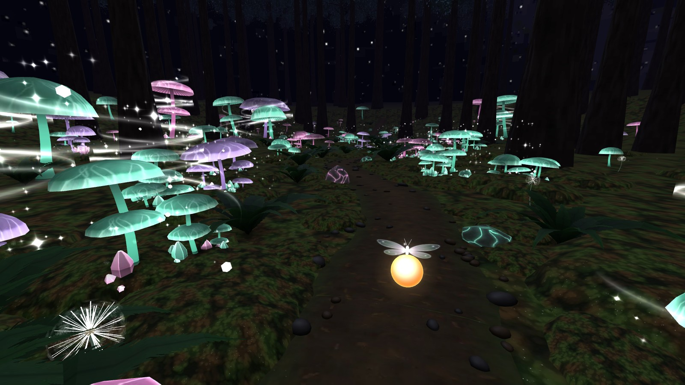
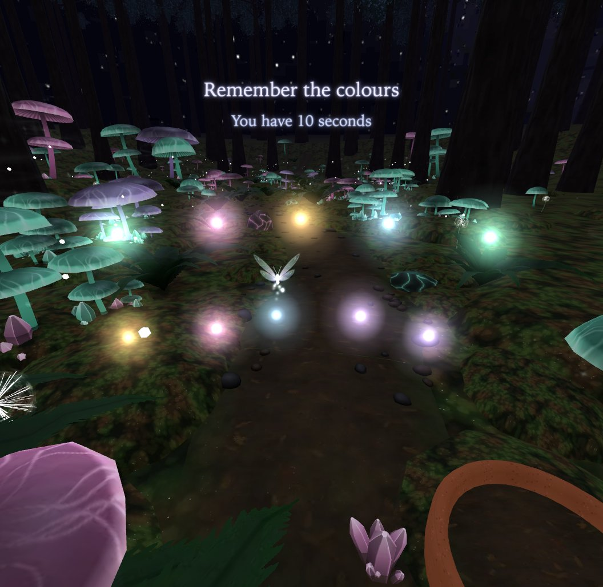
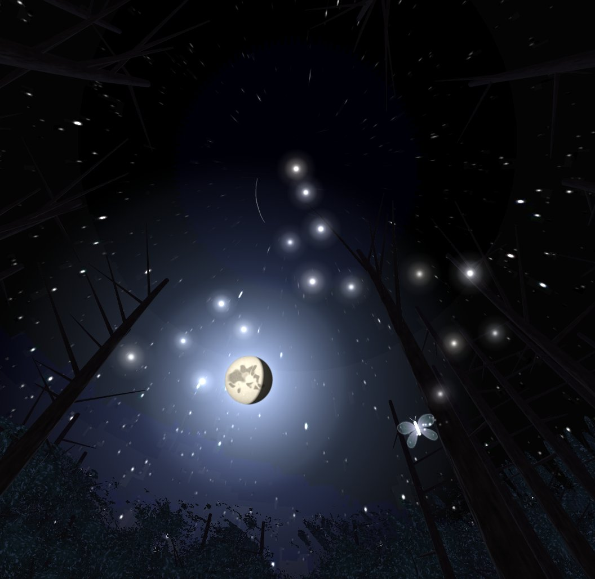
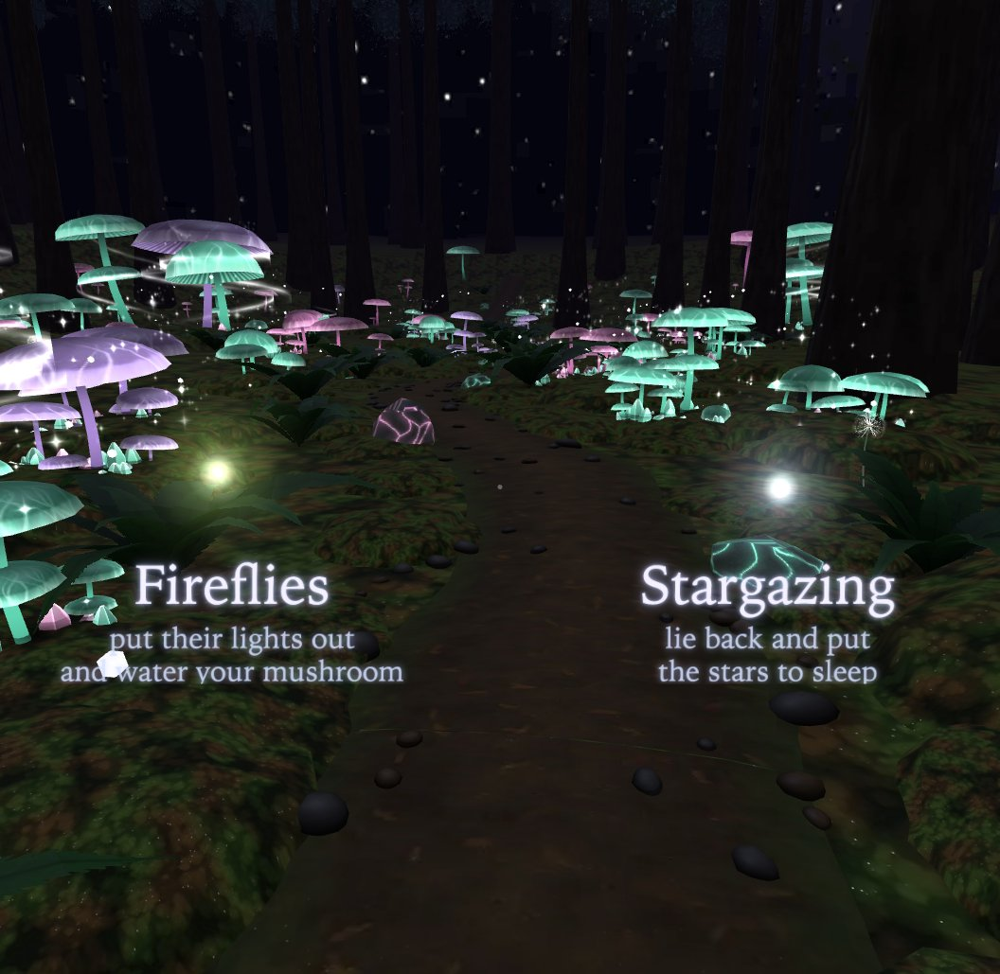
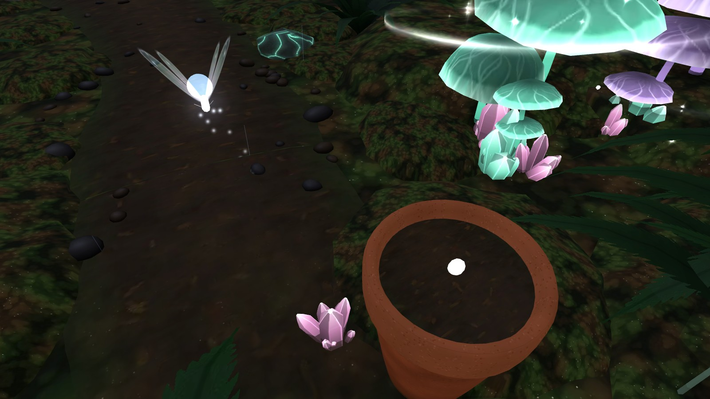
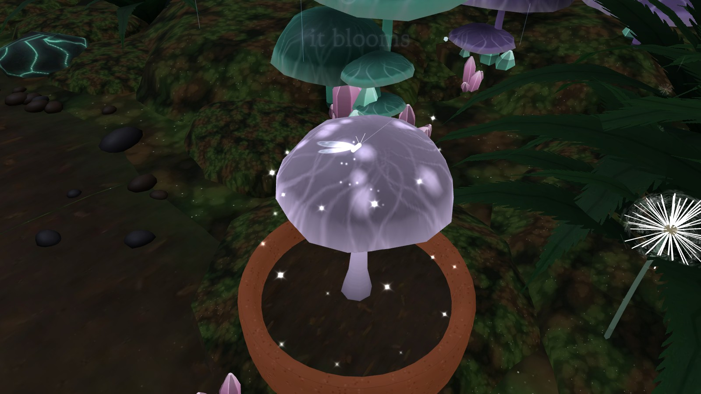
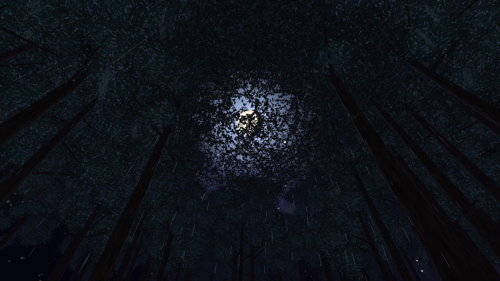
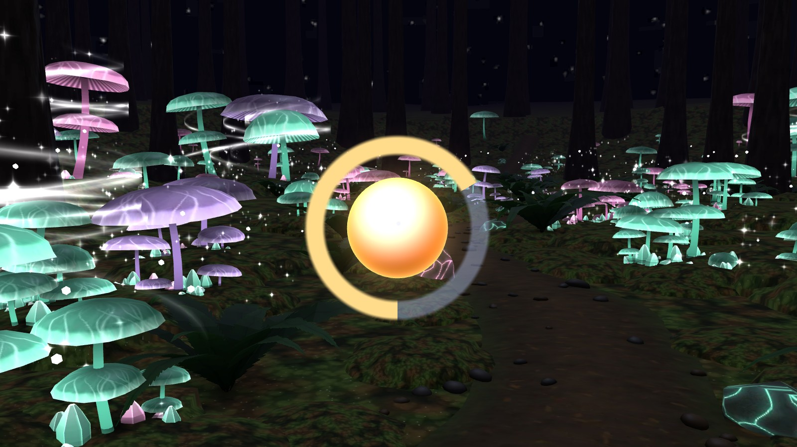

# Lights Out

**A quiet night in a glowing forest. Sit down, put your hands out, and tuck the forest in to sleep.**

Lights Out is a seated, hands-only VR wind-down for Meta Quest and Meta VR Glasses. Each night takes about ten minutes, needs no instructions, and ends with the forest asleep around you.

**▶ Play it:** open **https://jnemeth-project.github.io/lights-out/** in the Meta Quest browser and tap **Enter the forest**.



---

## A night in the forest

Each night you choose how to wind down. The first time, the butterfly and a few glowing words show you how.

- **Firefly memory.** The forest's glow quiets down and fireflies drift in to hover within reach. For ten seconds each one shows its colour: remember them. Then they all turn gold. Boop one to see its colour (and hear its note), then another: if they match, the pair goes to sleep together, and part of the forest with them. If not, they fade back and wait. No timer, no score; if you're stuck, a hidden pair briefly shimmers. You start with 10 fireflies, and each night you finish a board, the next night brings two more pairs. Then soft rain comes: cup your hands, catch it, and tip it into the terracotta pot to grow your mushroom.


- **Stargazing.** The trees overhead part and the sky opens. Lie back (or just look up), point at a star and pinch, and it goes to sleep. When the last star sleeps, so does the forest.



Every mushroom you boop has its own soft note, so sweeping a hand across them plays a calm little scale. At the end, the butterfly bows and drifts up toward the moon.

Nothing can go wrong. Nothing is timed. There are no menus floating in the air.

## Taught by a ghost butterfly, not by text

A small butterfly made of soft light shows you each gesture instead of explaining it. It boops the first matching pair of fireflies to show you how, twirls when you get it right, and cups its wings to gather rain before carrying it to the pot. Short glowing words appear where you're looking, so it's never unclear what to do.

| Choose tonight's wind-down | Shows you how to catch the rain |
| --- | --- |
|  |  |

## A reason to come back

- **Your magic mushroom.** One seed, watered once a night: sprout, then young, then bloom. Its colour is a secret until it blooms, and rare colours (Moonlight, Aurora) are, well, rare.
- **Your own corner of the forest.** Pick up each grown mushroom and place it around your seat. A new seed appears in the pot.
- **The real moon.** The moon follows tonight's actual phase. A full moon lights the treetops; a new moon leaves a darker, starrier sky.
- **On your first night,** the mushroom grows all the way to bloom, so you see the whole cycle before you take the headset off.

| Its colour is a mystery until it blooms | Tonight's moon, through the canopy |
| --- | --- |
|  |  |

## Everything you can touch

| In the forest | With your hands | With gaze and pinch (Meta VR Glasses) |
| --- | --- | --- |
| Firefly | Boop it to see its colour | Look at it, pinch |
| Star (stargazing) | Point at it and pinch | Look at it, pinch |
| Mushroom near you | Tap the cap: a deep, soft *boop*, and it slowly changes colour | Look, pinch |
| Fern | Brush through it for a soft swoosh | Look, pinch |
| Puffball | Tap it to release a cloud of glowing spores | Look, pinch |
| Dandelion | Brush it and its seeds drift away | Look, pinch |
| Rain | Cup your palm up to catch it, tip it over the pot | Look at the pot, pinch |
| Your grown mushroom | Pinch it, carry it, let go | Look and pinch to lift, look and pinch to place |

Every sound is generated live and kept low, round and soft: no chimes, nothing sharp.

## Made for everyone



- **Look to select:** no hands needed. Look at anything you can touch and a soft ring fills; when it's full, it's done.
- **One hand is enough** for everything, including catching and pouring the rain.
- **Just sit:** no tasks at all. The forest falls asleep on its own while you watch.
- **Brighter glow:** larger fireflies and brighter things to touch.
- **Fully seated,** everything within arm's reach, no walking, no flashing, no fail states.
- **Pauses** the moment the headset comes off.

The options are on the start screen and remembered between visits.

## Playing

- **Meta Quest 3 / 3S:** turn on hand tracking (*Settings → Movement tracking → Hand and body tracking*), open the link in the Meta Quest browser, put the controllers down, and tap **Enter the forest**. Sit comfortably with a little space around you.
- **Meta VR Glasses:** works with gaze and pinch.
- **On a computer:** choose **Look around on this screen**. Drag to look, click to touch.
- **See the butterfly's demonstrations again:** tap *Show me how to play* on the start screen, or add `?tutorial=1` to the link.

Best with headphones.

## How it's built

- The forest was modelled and textured in [Blender](https://www.blender.org/) (every model, texture and material made for this project), then exported as a single glTF file.
- The game is plain JavaScript on [three.js](https://threejs.org/) with WebXR: no install step, no build step.
- All sound effects are synthesised in the browser with the Web Audio API.
- Progress is saved on the device only. No account, no tracking.

```
index.html        start screen and options
src/main.js       the night: arrival, tucking in, rain, goodnight
src/fireflies.js  the firefly memory game
src/stars.js      stargazing: the sleepy stars and the opening canopy
src/choice.js     choosing tonight's activity
src/guide.js      the ghost butterfly
src/touch.js      boops, swooshes, puffs, dandelions
src/rain.js       rain, cupped hands, pouring
src/seed.js       the magic mushroom and your collection
src/gaze.js       look to select
src/audio.js      every sound
assets/           the forest and the background recording
```

To run it locally, serve the folder (for example `python3 -m http.server`) and open `http://localhost:8000`.

## Credits

- Concept, direction and design: **Joops**
- Background recording: *Evening nature with crickets, birds and distant dogs (part 2)* by **eryliaa**
- [three.js](https://threejs.org/) (MIT licence)

Made for the **Meta VR Start Developer Competition 2026**.
